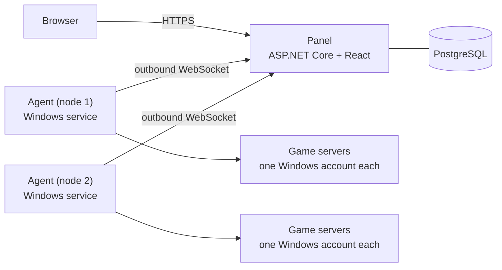

<div align="center">

# Pulsar

**A self-hosted web panel for game servers, built for Windows.**

[](https://github.com/Ayrton09/Pulsar/actions/workflows/ci.yml)
[](https://github.com/Ayrton09/Pulsar/releases/latest)
[](LICENSE)


[Install](#install) · [Features](#features) · [Games](#supported-games) · [How it works](#how-it-works) · [Docs](#documentation) · [Contributing](#contributing)

</div>

Pulsar runs your game servers on your own Windows machines and manages all of them from one web panel. It installs and
updates them with SteamCMD, shows their consoles live, edits their files, backs them up, runs scheduled tasks and gives
every friend or staff member exactly the access they need, on one server or on all of them.

## Install

In PowerShell **run as administrator**:

```powershell
irm https://github.com/Ayrton09/Pulsar/releases/latest/download/install.ps1 | iex
```

It checks the newest release against the project's signing key and opens its setup wizard, which installs what the PC
lacks (.NET 10, PostgreSQL 18) and then the panel, this PC as a node, or both. Then open the panel in a browser and
sign in with the administrator account the wizard created.

Other ways: download `PulsarSetup-<version>.exe` from [Releases](https://github.com/Ayrton09/Pulsar/releases), or
automate it with the release ZIP's `Install-Pulsar.ps1` ([step by step](docs/guides/install.md)). Once installed,
updates come from the panel with one click (Administration → Updates), signed and checked, with an automatic rollback
if the new version does not come up.

**Requirements:** Windows 11 or Windows Server 2022/2025, 64-bit, with Windows updates installed (Windows 10 22H2 on a
best-effort basis). The panel needs about 1 GB of RAM; each node needs the disk and memory of its games.

## Features

**Servers**
- Create, install, start, stop, restart and update servers from the browser; SteamCMD does the downloads (with a Steam
  account and Steam Guard for games that need one).
- Live console with commands and history, search and filters; RCON where the game has it.
- CPU, memory, uptime and players live, a usage history, and CPU and memory limits per server.
- Restart after a crash, start with the machine, and server templates you can tweak or write yourself.

**Files and data**
- File manager in the browser with a code editor, uploads and downloads, and SFTP access (passwords or SSH keys) for
  your favourite client.
- Backups on the node or on S3-compatible storage, on demand or on a schedule, that ask the game to save first;
  restores in place or clean.
- MySQL/MariaDB databases for game plugins, created per server.

**Mods and automation**
- One-click mod frameworks: Metamod:Source and CounterStrikeSharp for CS2, Oxide (uMod) and Carbon for Rust; Steam
  Workshop items where the game uses them.
- Scheduled tasks: start, stop, restart, back up, update or send a console command, in your time zone.
- Notifications to Discord or email when a server crashes or fails to start, a backup or a scheduled task fails, or a
  node goes offline or runs low on disk.
- A REST API (OpenAPI) with API keys limited to the permissions you choose.

**Security**
- Every game server runs as its own Windows account, in a Job Object, with access to its own folder only.
- Roles for the whole panel, for one node or for one server; two-factor authentication (TOTP) with recovery codes,
  enforceable per role; an audit log of every change.
- Nodes connect out to the panel with their own keys (optionally TLS client certificates): no port to open on them.
- HTTPS from the first start, with a certificate for your PC's names and addresses, or a free Let's Encrypt
  certificate for your public IP.

The panel and its notifications speak **English, Spanish, Brazilian Portuguese, French, Italian, German, Japanese,
Korean and Simplified Chinese**: each user picks theirs in My account (until then, the browser's).

## Supported games

| Game | Installed with | Console | Extras |
|---|---|---|---|
| Counter-Strike 2 | SteamCMD | log + RCON | Metamod:Source, CounterStrikeSharp |
| Counter-Strike: Source | SteamCMD | log + RCON | |
| Rust | SteamCMD | log + RCON | Oxide (uMod), Carbon |
| ARK: Survival Ascended | SteamCMD | log + RCON | |
| Palworld | SteamCMD | console + RCON | |
| 7 Days to Die | SteamCMD | console + telnet | |
| Project Zomboid | SteamCMD | console | Steam Workshop mods |
| Valheim | SteamCMD | console | |
| SCP: Secret Laboratory | SteamCMD | console | |
| Minecraft: Java Edition | Mojang's server, the version you choose | console | |

Each game is a declarative [manifest](games/): how to install, start, stop, back up and query it. Adding one needs no
change to Pulsar ([guide](docs/guides/manifests.md)).

## How it works



| Part | Technology |
|---|---|
| Panel | ASP.NET Core (.NET 10), SignalR, OpenAPI; a modular monolith |
| Database | PostgreSQL (the panel's data only) |
| Web app | React, TypeScript, Vite and Tailwind, served by the panel |
| Agent | .NET 10 Windows service: Job Objects, ConPTY, per-server accounts |

The design and its decisions are in [docs/architecture](docs/architecture/README.md) and the [ADRs](docs/adr/README.md).

## Documentation

| Guide | What it covers |
|---|---|
| [Install](docs/guides/install.md) | Requirements, the wizard, unattended and offline installs, nodes, HTTPS, troubleshooting |
| [Update](docs/guides/update.md) | One-click updates from the panel and updating by hand |
| [Backup](docs/guides/backup.md) | Backing up and restoring the panel itself |
| [Databases](docs/guides/databases.md) | MySQL/MariaDB hosts for game plugins |
| [SFTP](docs/guides/sftp.md) | Reaching server files with an SFTP client |
| [Manifests](docs/guides/manifests.md) | Adding a game |
| [Releasing](docs/guides/releasing.md) | How releases are built and signed |

## Building from source

Requirements: .NET SDK 10.0.400+ and Node.js 22+.

```bash
dotnet build
dotnet test
```

The web app lives in `src/Pulsar.Web` (`npm ci`, `npm run dev`). The integration tests need PostgreSQL and, for some,
MariaDB and S3: [CONTRIBUTING.md](CONTRIBUTING.md) has the whole development setup.

```
docs/      architecture, ADRs, spikes and user guides
games/     the game manifests (MIT)
schemas/   public JSON schemas (MIT)
scripts/   install, update, backup and release scripts
src/       panel, agent and web app
tests/     automated tests
```

## Contributing

Contributions are welcome: read [CONTRIBUTING.md](CONTRIBUTING.md) and the [Code of Conduct](CODE_OF_CONDUCT.md)
first. Please report security issues privately, as [SECURITY.md](SECURITY.md) explains, not in public issues.

## License

Pulsar is licensed under the [GNU Affero General Public License v3.0](LICENSE) (`AGPL-3.0-only`). The game manifests
in [`games/`](games/) and the schemas in [`schemas/`](schemas/) are under the MIT License.
